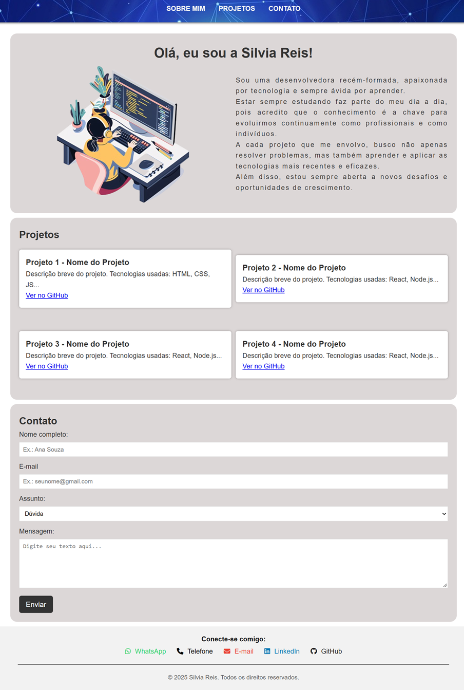

# Projeto: Página Simples - Curso B7Web

Este é um projeto desenvolvido durante as aulas do curso de **HTML e CSS - Fundamentos** da [B7Web](https://b7web.com.br). O objetivo principal foi praticar e consolidar os conceitos básicos de estruturação com HTML e estilização com CSS.

## 🚀 Tecnologias utilizadas

- **HTML5**: para estruturação do conteúdo.
- **CSS3**: para estilização e layout da página.

## 💡 O que foi praticado

- Estrutura básica de um documento HTML (`<html>`, `<head>`, `<body>`);
- Uso de tags semânticas como `<header>`, `<nav>`, `<section>`, `<footer>`;
- Criação de títulos, parágrafos, listas, links e imagens;
- Aplicação de estilos via CSS, incluindo:
  - Cores, fontes e tamanhos;
  - Box model (margens, paddings, bordas);
  - Layout com `display: flex`;
  - Organização e separação de estilos com um arquivo externo (`style.css`).

## 📸 Print da página

## 🌐 GitHub Pages

Você pode acessar a página online através deste link:  
👉 [Ver Página no GitHub Pages](https://silviareis1.github.io/fundamentos-html-css/)

## 📁 Estrutura do projeto
/pagina-simples  
├── index.html  
├── style.css  
└── img

## 📚 Créditos

Projeto desenvolvido como parte das atividades práticas do curso **B7Web - HTML e CSS: Fundamentos**.  
Instrutor: [Bonieky Lacerda](https://www.linkedin.com/in/bonieky/)

---

